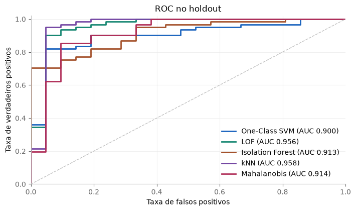

# Detecção de anomalias em parafusos

Projeto acadêmico de visão computacional clássica para identificar parafusos defeituosos e indicar regiões suspeitas na imagem. O ajuste dos detectores segue a abordagem *one-class*: cada modelo aprende com imagens de peças boas. Os defeitos entram na escolha de hiperparâmetros e na avaliação, em partições distintas.

## Dataset e pipeline

O dataset local segue as categorias de parafusos do MVTec AD. As **320 imagens de treino** foram confirmadas como boas pelo grupo. As **160 imagens de teste** incluem 41 boas e 119 defeitos nas categorias `manipulated_front` (24), `scratch_head` (24), `scratch_neck` (25), `thread_side` (23) e `thread_top` (23). O repositório publica os IDs relativos e os SHA-256 das imagens. [Inventário de reprodução](docs/results/reprodutibilidade/inventory.json)

A raiz do dataset deve conter `train/` e `test/`. O carregador aceita `train/good/*.png` ou `train/*.png` mediante declaração explícita de que todas as imagens planas são boas. Em `test/`, cada categoria tem sua própria pasta. A precedência é `--data-dir`, `DATASET_DIR` e `data/` na raiz do projeto. O carregador valida o layout e a leitura dos PNGs. [Carregador](src/dataset.py)

1. **Pré-processamento e segmentação.** Conversão para tons de cinza, filtro gaussiano 5 × 5, limiarização de Otsu invertida, abertura, fechamento e preenchimento de lacunas. O maior componente define a região de interesse (ROI), alinhada com o eixo do parafuso na horizontal e a cabeça à esquerda. [Extração global](src/extract_features.py) · [Cache de ROIs](src/roi_cache.py)
2. **Representação global.** A ROI recebe CLAHE e gera um vetor por imagem. A configuração de referência tem 25.413 atributos, incluindo 25.380 de HOG, 24 de Gabor, três de bordas e seis de geometria. As etapas globais também avaliaram versões com padronização e PCA. [Descritores](src/features.py) · [Representações](src/representations.py)
3. **Representação local.** A ROI alinhada é redimensionada para 384 × 128 px. Após CLAHE, o pipeline normaliza brilho e contraste por imagem com estatísticas da máscara. A grade avalia patches de 24, 32 e 48 px, com passo de meio patch. Cada posição recebe HOG local, LBP uniforme, resposta média absoluta de 12 filtros Gabor, densidade de bordas Canny e três medidas de silhueta. A grade compara o conjunto completo com a variante sem HOG. [Descritores locais](src/local_features.py)

## Da abordagem global à local

Na **etapa 8 histórica**, os modelos globais obtiveram AUC de 0,438 (SVM), 0,622 (LOF) e 0,634 (Isolation Forest) no teste completo. O diagnóstico por bloco mostrou AUC próxima de 0,5 para HOG global em várias configurações. Um risco ou uma deformação numa parte pequena da peça pode ter pouco peso num vetor que resume a ROI inteira. Com a ROI alinhada, cada posição da grade passa a comparar aproximadamente a mesma região entre parafusos. A agregação por imagem privilegia os patches mais anômalos. [Resultados globais históricos](docs/results/historico/etapa8_metricas.csv)

Na **etapa 9 histórica**, a comparação global × local no mesmo holdout registrou ganhos de AUC de 0,440 para 0,903 no SVM, de 0,561 para 0,958 no LOF e de 0,600 para 0,910 no Isolation Forest. O LOF histórico reduziu os falsos negativos de 53 para 2. A análise de ablação observou AUC de 0,916 para HOG local e de 0,964 para Gabor local, ambos isolados na seleção. [Comparação histórica no holdout](docs/results/historico/before_after.png) · [Ablação histórica](docs/results/historico/ablation.png)

A **reprodução no Windows** repetiu o protocolo para os três modelos e estendeu a avaliação a kNN e Mahalanobis. Os cinco resultados abaixo usam o mesmo holdout local. As contagens e as escolhas dos três modelos originais coincidiram com as históricas. Os manifestos históricos completos estão indisponíveis para confirmar a correspondência imagem a imagem. [Registro histórico da etapa 9](docs/results/historico/etapa9_metricas.csv) · [Resultados da reprodução](docs/results/README.md)

## Detectores locais

| Modelo | Score usado na etapa 9 |
|---|---|
| One-Class SVM | O negativo da função de decisão de um SVM com kernel RBF. A grade testa `nu` de 0,05 e 0,10 com `gamma=scale`. |
| LOF | O negativo do score de normalidade por densidade local em modo de novidade (`novelty=True`). A grade testa 10, 20 e 40 vizinhos. |
| Isolation Forest | O negativo do score de normalidade baseado no isolamento por árvores. A grade usa 200 árvores e `max_samples` igual a `auto` ou 512. |
| kNN | Distância euclidiana média aos `k` vizinhos ou distância ao k-ésimo, com `k` igual a 10, 20 ou 40. |
| Mahalanobis | Distância quadrática ao centro, considerando a covariância dos patches normais. A grade inclui Ledoit–Wolf e Elliptic Envelope. |

As 24 combinações com Elliptic Envelope foram numericamente inviáveis devido à deficiência de posto em pelo menos uma posição do ajuste local. A busca registrou o patch e o motivo e avaliou Ledoit–Wolf como configuração independente. [Implementação local](src/local_features.py) · [Detector kNN](src/knn.py) · [Detector Mahalanobis](src/mahalanobis.py) · [Grade com rejeições](docs/results/reproducao/selection_knn_mahalanobis_v1/runs.csv)

## Protocolo experimental

1. **Ajuste e reserva.** O manifesto externo usa semente 42 para separar 256 peças boas de desenvolvimento e 64 boas reservadas. O teste de 160 imagens fica fora do ajuste. Os manifestos internos registram as sementes 42, 43 e 44 usadas nas etapas globais. [Manifestos](docs/results/reprodutibilidade/)
2. **Divisão do teste.** A semente 2026 define uma divisão estratificada por categoria. A seleção contém 58 defeitos e 20 boas, com as 20 boas fora da escolha. O holdout contém 61 defeitos e 21 boas. A etapa 8 já havia examinado o teste completo, antes dessa divisão. [Divisão publicada](docs/results/reprodutibilidade/defect_split_v1.json)
3. **Ajuste cruzado por posição.** As 256 boas são divididas em duas dobras com semente 42. Para cada posição, uma dobra ajusta o `StandardScaler` e o detector com patches daquela posição e das vizinhas de raio 1 ou 2. A outra fornece a média e o desvio para padronizar os scores por posição. O procedimento inverte as dobras e calcula a média dos dois mapas padronizados. O score da imagem é o máximo ou a média dos três patches mais anômalos (`top3`).
4. **Seleção.** A grade cruza tamanhos de patch, descritores completos ou sem HOG, raios espaciais, agregações e parâmetros do detector. São 168 combinações e oito ablações no grupo original e 192 combinações, incluindo 24 inviáveis, no grupo kNN/Mahalanobis. Cada modelo é escolhido pela AUC entre as 64 boas reservadas e os 58 defeitos de seleção. O código compara a AUC arredondada a seis casas, depois o recall no ponto-alvo de 95% de especificidade e por fim a menor dimensão.
5. **Calibração e holdout.** O limiar do score agregado é o quantil de 95% das 64 boas reservadas, com `method="higher"`. Um score estritamente acima do limiar indica defeito. O holdout mede o desempenho das configurações já escolhidas, com defeito como classe positiva. Um falso negativo é um defeito aprovado. A meta de 5% de falsas rejeições refere-se à calibração.

[Divisão estratificada](src/defect_split.py) · [Busca e avaliação](src/stage9_experiments.py) · [Grades publicadas](docs/results/reproducao/)

## Resultados finais da reprodução

Todos os modelos selecionaram `top3` como agregação por imagem.

| Modelo | Patch (px) | Descritores | Raio | Hiperparâmetros | AUC seleção |
|---|---:|---|---:|---|---:|
| One-Class SVM | 24 | Todos | 1 | RBF, `nu=0,05`, `gamma=scale` | 0,9744 |
| LOF | 32 | Todos | 1 | 10 vizinhos | 0,9841 |
| Isolation Forest | 24 | Sem HOG | 1 | 200 árvores, `max_samples=512` | 0,9480 |
| kNN | 24 | Todos | 2 | `k=10`, euclidiana, média das distâncias | 0,9828 |
| Mahalanobis | 24 | Todos | 1 | Ledoit–Wolf | 0,9755 |

[Hiperparâmetros publicados](docs/results/avaliacao_final/hiperparametros.json)

| Modelo | VP | FN | VN | FP | Recall | Especificidade | AUC holdout |
|---|---:|---:|---:|---:|---:|---:|---:|
| One-Class SVM | 50 | 11 | 20 | 1 | 82,0% | 95,2% | 0,9001 |
| LOF | 58 | 3 | 18 | 3 | 95,1% | 85,7% | 0,9555 |
| Isolation Forest | 42 | 19 | 21 | 0 | 68,9% | 100,0% | 0,9126 |
| kNN | 55 | 6 | 20 | 1 | 90,2% | 95,2% | 0,9578 |
| Mahalanobis | 50 | 11 | 19 | 2 | 82,0% | 90,5% | 0,9141 |

[CSV de métricas](docs/results/avaliacao_final/metricas.csv) · [Predições de SVM, LOF e Isolation Forest](docs/results/avaliacao_final/final_v1/predictions.csv) · [Predições de kNN e Mahalanobis](docs/results/avaliacao_final/final_knn_mahalanobis_v1/predictions.csv) · [Recall por categoria](docs/results/avaliacao_final/recall_por_categoria.csv)



[Matrizes de confusão](docs/results/avaliacao_final/figuras/matrizes_confusao.png) · [Gráfico de recall por categoria](docs/results/avaliacao_final/figuras/recall_por_categoria.png) · [Mapas de anomalia dos cinco modelos](docs/results/avaliacao_final/figuras/mapas_anomalia.png)

Na reprodução, o LOF teve o maior recall no limiar usado, detectando 58 dos 61 defeitos e rejeitando três das 21 peças boas. O kNN teve a maior AUC observada e rejeitou uma peça boa, com seis defeitos aprovados. A diferença de AUC entre os dois foi de cerca de 0,0023. Esses números descrevem a amostra observada e o ponto operacional adotado.

### Limitações

- O holdout contém 61 defeitos e 21 boas. Uma imagem boa representa cerca de 4,8 pontos percentuais de especificidade. As diferenças observadas entre modelos carecem de teste estatístico ou validação externa.
- A etapa 8 consultou o teste completo antes da etapa local. A divisão posterior protegeu a busca da etapa 9, mas a motivação para a mudança de representação veio desse diagnóstico. A AUC de seleção é uma métrica usada para escolher configurações e pode ser otimista. O estudo não mediu a variabilidade entre diferentes divisões.
- Na inspeção histórica, as boas do teste eram mais escuras que as boas reservadas e os defeitos. A normalização local busca reduzir esse efeito. A comparação adicional entre as boas reservadas e os defeitos do holdout está publicada separadamente no CSV de métricas. [Diagnóstico histórico](docs/relatorio/img/brightness_robustness.png)
- Os mapas localizam patches de score alto. Eles são ilustrações qualitativas e não há uma avaliação quantitativa de localização contra máscaras de defeito.

## Instalação e reprodução

Use Python 3.12. Para a reprodução Windows publicada, as versões instaladas estão registradas no [ambiente da execução](docs/results/reprodutibilidade/environment.json). O [requirements.txt](requirements.txt) lista as dependências sem travar todas as versões. Diferenças de plataforma e bibliotecas podem alterar valores numéricos.

### Windows · PowerShell

```powershell
py -3.12 -m venv .venv
$Py = ".\.venv\Scripts\python.exe"
& $Py -m pip install -r requirements.txt
& $Py -m pip check

$env:PYTHONUTF8 = "1"
$env:OPENBLAS_NUM_THREADS = "1"
$env:OMP_NUM_THREADS = "1"
$env:MKL_NUM_THREADS = "1"
& $Py -m unittest discover -s tests -v
```

### Linux · Bash

```bash
python3.12 -m venv .venv
source .venv/bin/activate
python -m pip install -r requirements.txt
python -m pip check

export PYTHONUTF8=1 OPENBLAS_NUM_THREADS=1 OMP_NUM_THREADS=1 MKL_NUM_THREADS=1
python -m unittest discover -s tests -v
```

### Visualizar os resultados sem retreinar

Abra o [notebook 04 no GitHub](notebooks/04_avaliacao_classica.ipynb) para ver as saídas salvas. Para executar as células, instale o ambiente acima e abra o JupyterLab na raiz do clone com `& $Py -m jupyterlab` no PowerShell ou `python -m jupyterlab` no Linux. Selecione um kernel do ambiente, abra `notebooks/04_avaliacao_classica.ipynb` e use **Run All**. O notebook lê [os resultados publicados](docs/results/README.md) e exibe tabelas, curvas ROC, matrizes de confusão, recall por categoria e mapas renderizados. O dataset e o cache de ROIs só são necessários para reproduzir os experimentos.

### Reexecutar os experimentos locais

Execute na raiz do projeto. Aponte `DATASET_DIR` para a pasta que já contém `train/` e `test/`. Declare `TRAIN_FLAT_IS_GOOD=true` apenas para o layout plano após confirmar os rótulos. Para `train/good/`, deixe a variável ausente ou defina `false`.

```powershell
$env:DATASET_DIR = "D:\datasets\screw"
$env:TRAIN_FLAT_IS_GOOD = "true"
```

```bash
export DATASET_DIR="/caminho/para/screw"
export TRAIN_FLAT_IS_GOOD=true
```

Os comandos abaixo iniciam uma execução com destinos ainda não existentes. No PowerShell, substitua o primeiro `python` de cada linha por `& $Py`. A geração do estudo e do cache verifica o inventário e os hashes das imagens. A etapa 9 carrega o split e o cache nos caminhos mostrados. Para continuar uma seleção interrompida, repita seu comando com `--resume`.

```text
python -m src.dataset
python -m src.feature_experiments prepare --out results/stage3/study_v1
python -m src.defect_split --study results/stage3/study_v1 --out results/stage9/defect_split_v1.json
python -m src.roi_cache --study results/stage3/study_v1 --out results/stage9/roi_cache_v1.npz
python -m src.stage9_experiments select --out results/stage9/selection_v1
python -m src.stage9_experiments final --selection results/stage9/selection_v1/selection.json --out results/stage9/final_v1
python -m src.stage9_experiments select --models knn-mahalanobis --out results/stage9/selection_knn_mahalanobis_v1
python -m src.stage9_experiments final --selection results/stage9/selection_knn_mahalanobis_v1/selection.json --out results/stage9/final_knn_mahalanobis_v1
```

Os manifestos de execução usam IDs absolutos e os artefatos assinados registram hashes dos bytes dos arquivos, incluindo fontes. Gere os artefatos encadeados no mesmo checkout. Para conferir a publicação, use os manifestos portáteis de `docs/results/` e compare os IDs relativos e os SHA-256. [Proveniência e checksums](docs/results/README.md)

## Estrutura do repositório

| Caminho | Conteúdo |
|---|---|
| [`src/`](src/) | Carregador, pré-processamento, descritores, detectores, validação e experimentos clássicos. |
| [`tests/`](tests/) | Suíte de validação, integridade e experimentos sintéticos. |
| [`notebooks/`](notebooks/) | Exemplos de pré-processamento, características, abordagem global e avaliação local. |
| [`docs/results/`](docs/results/README.md) | Exportação leve do histórico, reprodução, avaliação final e hashes. |
| [`docs/relatorio/`](docs/relatorio/index.html) e [`docs/poster/`](docs/poster/poster_a3.pdf) | Relatório e pôster da versão anterior, com atualização prevista para uma próxima etapa. |
| [`ALTERACOES.md`](ALTERACOES.md) | Histórico técnico das etapas e mudanças recentes. |

`data/`, `models/` e `results/` são pastas locais ignoradas pelo Git. A avaliação final dos cinco modelos está no notebook e em `docs/results/`.
